# jobsearch-autopilot

An autonomous job-application agent for the German job market. Every evening it
finds new openings for a candidate, drops the ones that don't fit, and writes a
tailored CV and cover letter (Anschreiben) for each. Every morning it submits
the applications by email or through job portals, reads employer replies,
updates the candidate's tracker and sends the operator a report.

The engine runs several candidates from one codebase. Each candidate is a
folder of YAML and Markdown in a separate private data repository; this
repository holds only code, prompts, tests and one fictional example candidate,
Erika Mustermann (`examples/clients/erika`).

## Production context

- In daily use since May 2026, first for one candidate and since October 2026
  as a multi-tenant engine (three candidate profiles, paused or active
  independently). The busiest tracker has about 260 applications.
- Runs unattended from cron on a self-hosted Proxmox LXC container (Debian 13,
  4 vCPU, 8 GB RAM): 20:30 discovery, 03:00 applications.
- The agent is Claude Code in headless mode (`claude -p`), one run per
  candidate, with the prompt rendered from a Jinja template and that
  candidate's config.
- Python, about 15.7k lines including 4.7k lines of tests; 439 pytest tests
  (438 pass, 1 skips without the optional `anthropic` SDK), all offline.
- Playwright apply modules for StepStone, XING, Interamt (German public
  sector) and Oracle CX Recruiting, plus shared form-filling helpers. The
  production deployment also runs two employer-specific career-site modules;
  they are left out of this public copy because they name the employers.

## How it works

```mermaid
flowchart LR
    cron[cron on Proxmox LXC] --> runner[run_all.sh<br/>one candidate at a time, shared lock]
    runner --> render[render_run.py<br/>prompt + MCP config + hooks]
    render --> claude[Claude Code headless]

    subgraph evening [Evening: discover]
        claude --> search[search queries<br/>Perplexity, career pages, job alerts]
        search --> discover[--discover<br/>liveness, scoring]
        discover --> rules[bot.filters.rules<br/>exclusions, location, dedup vs tracker]
        rules --> tailor[tailoring<br/>CV variant + cover letter]
        tailor --> batch[(batch.json)]
    end

    subgraph morning [Morning: apply]
        batch --> pkg[--batch-render<br/>PDF + DOCX]
        pkg --> email[email channel<br/>Gmail via MCP]
        pkg --> apply[bot.apply.runner<br/>Playwright portal modules]
        apply --> manual[unsupported ATS, CAPTCHA, login:<br/>direct link to operator]
        email --> replies[employer replies<br/>confirmation, rejection, interview]
        apply --> replies
        replies --> tracker[(tracker.md in data repo)]
        tracker --> report[operator report + git push]
    end
```



Python does everything that can be checked by a test: liveness checks,
scoring, filters, deduplication against the tracker, document rendering and
portal form filling. The model writes search queries and cover-letter text and
reads email, the parts that need judgement on natural language.

## Guardrails

Applications go out under a real person's name, so a large share of the code
checks or limits what the agent does.

- Dry-run mode. `APPLY_MODE=dry-run` prepares everything and sends nothing;
  portal modules stop on the page with the submit button and take a
  screenshot. New candidates and new portal modules start here.
- Per-run cap. `max_submissions_per_run` (default 25), lowered with
  `APPLY_GUARD_LIMIT` during trials.
- Idempotency. A package whose `apply_result.json` says `submitted` is never
  submitted again.
- Fail closed. An unknown form state, a CAPTCHA or a missing submit button
  returns `form_unsupported` or `captcha` with a screenshot, and the job lands
  on the operator's manual list. CAPTCHAs are solved by a human only.
- Mail safety hook. `scripts/hooks/guard_gmail_delete.py` is a Claude Code
  `PreToolUse` hook that blocks deletes on mailboxes marked `may_delete: false`.
- Output validators. `scripts/validate_run_msgids.py` checks every Gmail
  message ID the agent wrote into the tracker against the real mailbox, after a
  run where the model invented one. Tests in `tests/test_render_honesty.py`
  keep the renderer from reporting a send before it happens.
- Privacy check. `scripts/check_no_private_data.py` collects names,
  addresses, phone numbers and employers from every candidate folder and fails
  if any of them appears in this repository.

## Run it on the example candidate

Tested on Python 3.14; the code needs at least 3.10.

```bash
python3 -m venv .venv && .venv/bin/pip install -r requirements.txt
.venv/bin/playwright install chromium
.venv/bin/python -m pytest -q          # tests run against examples/clients/erika

export JOBSEARCH_CLIENTS_DIR=$PWD/examples/clients
.venv/bin/python -m bot.clients list
.venv/bin/python -m bot.onboard check --client erika --render
# sample CV and cover letter per track in
# examples/clients/erika/var/run/onboarding_sample/<track>/
```

The `check` step warns that Gmail OAuth and the browser profile are missing.
That is expected: a live run needs two Gmail mailboxes connected through MCP,
logged-in portal sessions, a Claude Code subscription and the API keys listed
in `docs/server_setup.md`.

## Repository layout

```
bot/            scrapers, filters, CV and letter generation, portal apply modules
docs/agents/    evening and morning agent prompts (Jinja templates)
scripts/        operator tools, Gmail REST helpers, hooks, server wrappers
templates/      skeleton for a new candidate folder
examples/       Erika, the fictional candidate used by the tests
tests/          pytest suite, synthetic fixtures only
```

## Language

The engine targets the German market, so the generated documents, portal
answers and most string matching are in German. The agent prompts, code
comments, operator reports and the internal docs (`docs/*.md`,
`docs/README.uk.md`, `CLAUDE.md`) are in Ukrainian, the working language of the
people who run it. This README is the only English document.

## Known limits

- Germany only: portals, application format and letter style are German.
- One candidate per process. Config is read into module constants at import
  time; running two candidates in one process would need an explicit context
  object.
- Portal modules break when a portal changes its markup. Each module fails
  closed, but someone has to update the selectors.
- LinkedIn Easy Apply and most corporate ATS are not automated; they end up on
  the manual list with a direct link.
- Automated submission may conflict with a portal's terms of use. That risk
  sits with the account owner, and the candidate's explicit consent is required.
- The direct-API tailoring path (`bot/generators/tailor.py`) needs the optional
  `anthropic` package; the production path tailors inside the Claude Code run.
